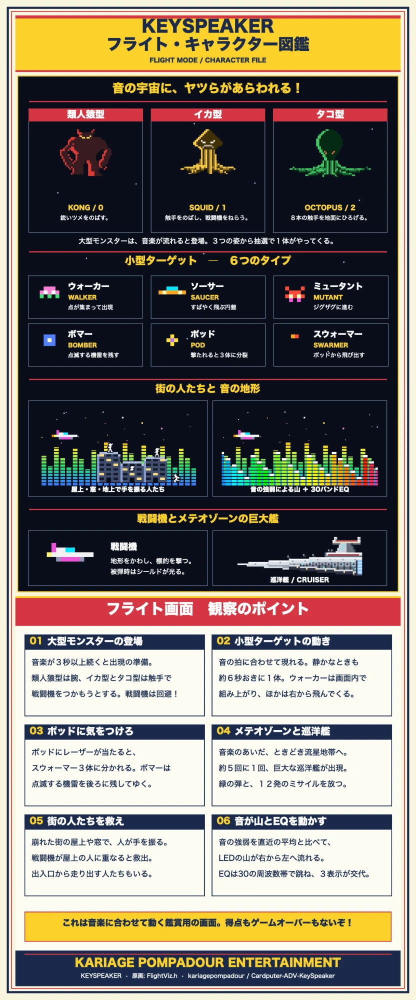

# KeySpeaker WEB DEMO

[English](README.md)(メイン)· ページ本体は英語が標準で、右上のボタンで日本語に切り替えられます。

Cardputer ADV 版 KeySpeaker の実機デモです。240 x 135 のキャンバスに画面を実機どおりに描き、ブラウザでできる範囲で実機の動きを再現しています。HTML / CSS / JavaScript だけで動きます(`index.html` を開くか、フォルダを配信。GitHub Pages 可)。スマホのホーム画面にも追加できます(PWA)。

ファームウェア(`KeySpeaker_S0.ino`、`FlightViz.h`、`KeyEarth.h`、`Splash.h`)から移植した画面:

- **起動画面**と**待機中のエンブレム**: ファームウェアの元画像をそのまま使っています。計測モードで 1 分間キーも音もないとエンブレムに戻り、`h HELP  Fn+M KEYBOARD` を表示し、大きな拍で揺れ、キーを押すと復帰します(そのキーは復帰だけ)。
- **計測モード**: 計測画面。バッファやカウンタ、PC 音量はデモ値で、レベルメーターは音に追従します。
- **飛行モード**: 音の大きさが地形になり、宇宙船が的を撃ちボムでクレーターを作ります。30 バンドの EQ は 1 分ごと・曲の切れ目で自動的に入れ替わります。音楽が鳴っている間は、ときどきスペースインベーダーの筐体に描かれていたモンスターが地形の奥から歩いてきて、爪のある手を一番手前に伸ばして宇宙船をつかもうとし、空振りします。訪問のうち半分は、別のモンスター（スペースインベーダーのイカ）が来ます。尖った頭の下の7本の触手がふわりと浮かんで進み、宇宙船が通り過ぎる前と、通り過ぎたあとに、ときどき宇宙船のほうへ触手を伸ばします。また、ときどき地面にサーチライト（小さな基地つき）が立って、地形と一緒に流れながら、細い光の筋で空を掃きます（厳戒態勢の街）。光は、モンスターの体の中心線と、宇宙船のところで止まります。さらに、ときどき、壊れかけた3〜5棟のビルが地形と一緒に流れてきて、屋上や窓でサウンドテラリウムの小さな人が手を振って助けを求めます。宇宙船は近くの人のところへ飛んで助けます（小さな光が出るだけで、得点はありません）。入口から数人が走り出て、宇宙船を追いかけて手を振ることもあります。また、20回に1回、モンスターがショッキングピンクで現れます。（アドレスに付ける試用の切り替え: ?city=now、?lights=now、?pink=1）
- **キーボード(文字入力)モード**: 回る地球と「KEY BOARD」、Mac/Win と A/あ、キー一覧、G0 を押している間の MOUSE 画面。
- **ヘルプ画面**: 実機と同じキー一覧。

メテオゾーン（試作）：ときどき地形が低くなり、流星が右から左へ流れ、戦闘機がその間をすり抜けます。アドレスの最後に `?meteor=now` を付けると、始まってすぐに見られ、そのあと8秒ごとに来ます。

`Fn+M` で 計測 → 飛行 → キーボード と切り替わり、最後のモードは記憶されます(初回は飛行)。

飛行モードで出会えるものの図鑑です(デモの横にも出ています。クリックすると大きく見られます)。

## 音源

音源は、実際の音が2種類と、テスト音です。同時に動くのは1つだけで、どれかを選ぶと他は止まります。

- **START**(パソコン用): このパソコンで再生している音を、ブラウザの画面/タブ共有(`getDisplayMedia`)で取り込みます。音を出しているタブ(または画面)を選んで「音声を共有」にチェックしてください。Windows の Chrome / Edge は「画面全体」でシステム全体の音、Mac / Linux はタブの音を取り込めます。映像は捨てます。Safari と Firefox は音を共有できません(音楽は同じブラウザの別のタブで鳴らしてください)。
- **MIC START**(スマホ用。パソコンでも選べます): マイク(`getUserMedia`)の音を取り込みます。マイクの使用許可は、このボタンを押したときだけブラウザに求めます。ページは HTTPS(または `localhost`)で開く必要があります。スマホのブラウザは、スマホ自身が再生している音を取り込めないため、スマホでは START を表示せず、MIC START が主なボタンになります。許可しなかった場合は、ブラウザのサイト設定でマイクを許可してから、もう一度押してください。画面ロック・通話・ほかのアプリの使用などでマイクが止まった場合は、数秒待ってから停止し、もう一度 MIC START を押すよう案内します(止まったマイクをブラウザが自動で復帰させる保証はないためです)。
- **テスト音**: 音を共有せず、マイクも使わずに、合成した曲を画面に流します。

どの音も、画面に反応させるためにブラウザ内で解析するだけです。スピーカーからは鳴らさず、録音も送信もしません。ボタンの下の1行は、ページが受け取っている音の状態です。START・MIC START・全画面は、実機にないキーなのでボタンだけです。

## キー(実機の割り当て。`Fn` は PC では `Shift`)

`[` `]` 音量 / `\` ミュート / `space` 再生・停止 / `,` `/` 前後の曲 / `-` `=` ブースト / `b` 低音カット(以上は画面表示のみ変化)/ `r` カウンタリセット / `v` 計測⇄飛行 / `h` または役のないキー ヘルプ / `Fn+M` 次のモード / `Fn+I` 入力の切り替え(USBの音 ⇄ マイク。WEB版では MIC START と同じ)/ `Fn+O` Mac/Win / `Fn+A` AUX / `Fn+[` `Fn+]` A / あ / G0 ボタン長押し MOUSE 画面。

注意: BLE は表示されません(接続表示は常に USB)。実機をパソコンにつないでいても、実機のキー操作はページに反映されません(使えるのはパソコンのキーボードと画面のボタンだけ)。

再現していないもの: PC へのキー・マウス・メディアキー送信、USB/BLE、Grove の AUX 入力、スピーカー。

MIT ライセンス(`LICENSE`)。エンブレムはカリポムのもので、ファームウェア側のプロジェクトから使っています。
